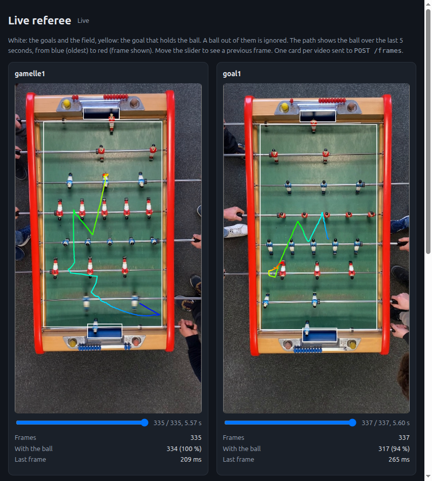
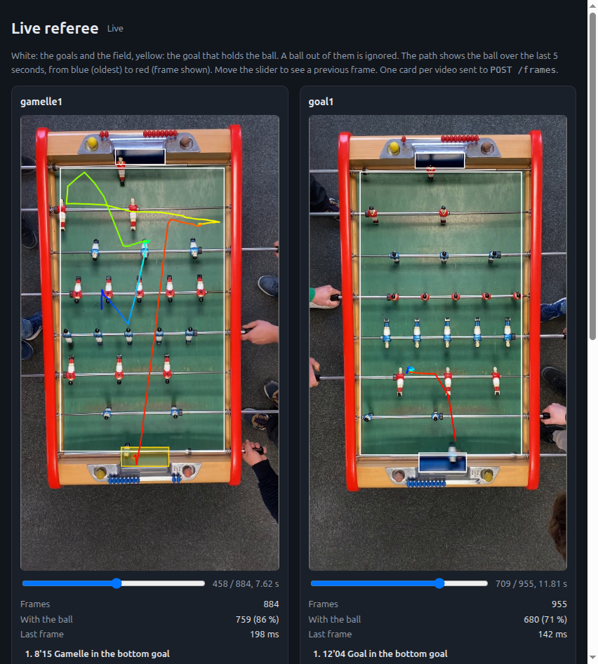

# Yagamel Live Referee

**A table football referee that watches every frame, live, in PHP.**

## Description

You film a game of table football from above. The referee watches the video, frame after frame, and tells you when
there is a goal or a "gamelle". A gamelle is a ball that goes into the goal and comes out again.

A small Python script reads the video and sends each frame to a Symfony app. Then PHP does all the work:

1. It finds the table on the first frame: the blue goals and the green field.
2. It asks a YOLO model where the ball is, with [Symfony AI](https://symfony.com/doc/current/ai/index.html).
3. It follows the ball and decides:
   - **goal**: the ball goes into a goal, then you do not see it any more;
   - **gamelle**: the ball goes into a goal, then it comes back on the field.
4. It sends the result to your browser with Mercure, at once.

The live page shows each video as it comes: the frame, the path of the ball, and the calls of the referee. Use the
slider to go back in time and see how a goal happened.

Built with Symfony 8, FrankenPHP (worker mode and its Mercure hub), Symfony AI, Symfony UX (Stimulus and AssetMapper)
and OpenVINO Model Server. The YOLO model that finds the ball comes from the Yagamel project.

## Usage

You need Docker with Compose, and [Git LFS](https://git-lfs.com/) for the model and the sample videos.

```bash
git lfs install
git clone https://github.com/Jean-Beru/symfonyai-hackathon-2026-yagamel.git
cd symfonyai-hackathon-2026-yagamel
docker compose up -d --build --wait php
```

Open http://localhost:8080/live, then send a video:

```bash
docker compose run --rm sender /videos/gamelle1.mov
```

Try the other sample videos too: `goal1.mov` and `goal_and_demi.mov`. To send your own video, put it in
`referee/videos/`.

Change the referee with environment variables, without a rebuild:

```bash
GOAL_MISSING_FRAMES=20 GAMELLE_OUTSIDE_FRAMES=8 PATH_SECONDS=3 docker compose up -d php
```

| Variable | Default | What it does |
| --- | --- | --- |
| `GOAL_MISSING_FRAMES` | `15` | A goal: the number of frames without the ball, after the ball is in a goal |
| `GAMELLE_OUTSIDE_FRAMES` | `5` | A gamelle: the number of frames with the ball out of the goal again |
| `REFEREE_MIN_CONFIDENCE` | `0.3` | The minimum confidence of YOLO to say "this is the ball" |
| `PATH_SECONDS` | `5` | The live page shows the path of the ball over this number of seconds |

Run the tests:

```bash
docker compose run --build --rm php_test                          # fast, YOLO is mocked
docker compose run --build --rm php_test --testsuite integration  # with the real model
```

The API, the settings and the measures are in [docs/technical.md](docs/technical.md).

## Screenshots

**Live.** One card per video. White boxes show the goals and the field. The path of the ball goes from blue (old) to
red (now).



**Replay.** Move the slider to see a past frame. On the left, the ball is in the bottom goal (yellow) just before it
comes out: a gamelle. On the right, a fast shot into the bottom goal: a goal. The calls of the referee are under each
card.


