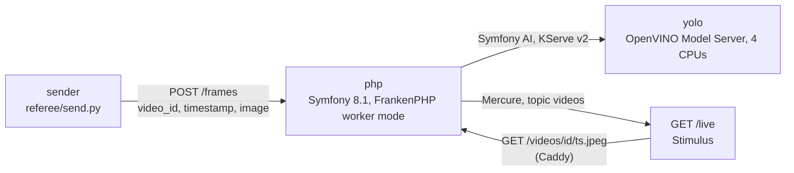

# Live referee: technical notes

A Symfony API that referees a table football video, frame after frame. A Python sender only reads the video and sends
each frame, in order, one at a time. PHP finds the table and the ball, decides a goal or a gamelle, and shows each
frame live on a page served by PHP.



For each frame, `App\Frame\FrameAnalyzer`:

1. Letterboxes the frame to 544 x 960 with GD (`App\Frame\Letterbox`).
2. Writes it to `var/videos/<video_id>/<timestamp>.jpeg` (`App\Frame\FrameStorage`). Caddy serves this folder on
   `/videos/`.
3. Finds the table on the first frame of the video, then reads it from the cache (`App\Table\VideoTable`). In
   plain PHP, about 20 ms (`App\Table\TableDetector`):
   - the goals are the largest blue blobs at both ends;
   - the field is the box of the rows and the columns that are green on a quarter of their length at least.
4. Asks YOLO for the ball (`App\Detection\BallDetector`). The ball is the best candidate from
   `REFEREE_MIN_CONFIDENCE`, on the field or in a goal. The spare balls, the hands and the floor are out of them.
5. Decides (`App\Referee\Referee`). When the ball is in a goal, then:
   - no ball for `GOAL_MISSING_FRAMES` frames in a row: a goal;
   - the ball out of the goal for `GAMELLE_OUTSIDE_FRAMES` frames: a gamelle.

   The ball is also in a goal when its next position, at the same speed, is in the goal. The model often sees a fast
   ball last just in front of the goal, and hardly sees it on the blue of the goal.

Then `App\Viewer\FramePublisher` publishes the analysis to the Mercure hub of FrankenPHP, with `mercure_publish()` (no
HTTP).

The table and the state of the referee stay in the cache pool `referee.cache` (filesystem): the workers of
FrankenPHP share no memory. The state needs the frames of a video in order, and a new `video_id` for each run: the
sender adds the time to the name of the file.

Results on the 3 videos (defaults of `api/app/.env`): goal1, a goal in the bottom goal at 12.04 s; gamelle1, a
gamelle in the bottom goal at 8.15 s; goal_and_demi, goals at 11.61 s (top) and 18.13 s (bottom).

## Live page

Open http://localhost:8080/live, then start the sender. The page shows one card per video:

- the frame, the goals and the field in white, the goal that holds the ball in yellow;
- the path of the ball over the last `PATH_SECONDS` seconds, from blue (oldest frame) to red (frame shown);
- a slider: it shows a previous frame and the path up to it. Move it to the end to follow the video again;
- the decisions, for example `8'15 Gamelle in the bottom goal`.

The page subscribes to the hub without a token and keeps the frames: the API sends one frame at a time.

The publisher key is a placeholder (`!ChangeThisMercureHubJWTSecretKey!`): set `MERCURE_JWT_SECRET` on the host before
any use outside the LAN of the PoC.

## Run

```bash
docker compose up -d --build --wait php                    # yolo, then php on http://localhost:8080
docker compose run --build --rm sender /videos/goal1.mov   # also gamelle1.mov, goal_and_demi.mov
GOAL_MISSING_FRAMES=20 docker compose up -d php            # change a setting, no rebuild
docker compose run --build --rm php_test                   # unit and functional tests, YOLO mocked
docker compose run --build --rm php_test --testsuite integration   # the real model, needs the yolo service
```

The sender takes `--url`, `--video-id` and `--seconds` (the length to send, 20 by default). It prints each decision,
then a JSON summary with the ratio of the processing time to the length of the video.

## API

`POST /frames`, `multipart/form-data`:

- `video_id`: 1 to 64 characters among `A-Z a-z 0-9 _ -`;
- `timestamp`: the time of the frame in the video, in ms (0 or more);
- `image`: the frame, a JPEG of any size, 8 MB at most.

```json
{"video_id": "gamelle1-1795357098", "timestamp": 8150,
 "table": {"top": [224, 84, 328, 112], "bottom": [232, 712, 332, 752], "field": [108, 120, 448, 716]},
 "ball": {"box": [303.03, 524.72, 319.04, 540.65], "center": [311.03, 532.69], "confidence": 0.79},
 "decision": {"call": "gamelle", "goal": "bottom"}, "processing_ms": 81}
```

The boxes are `[x1, y1, x2, y2]` in pixels of the letterboxed frame (544 x 960). `table` is null until the goals and
the field are found, `ball` is null when the frame has no ball, `decision` is null on most frames.

Errors, as `application/problem+json`:

| Code | Case |
| --- | --- |
| 413 | A body over 9 MiB: Caddy answers with a plain 413. |
| 422 | `video_id`, `timestamp` or `image` missing or invalid, not a JPEG |
| 502 | YOLO failed or gave an unexpected output |
| 504 | YOLO did not answer in `YOLO_TIMEOUT` seconds |

An unexpected error stays a 500 rendered by Symfony, not `problem+json`.

`GET /live` is the live page. `GET /health` returns 200 and does not call YOLO.

## Configuration

| Variable | Default | Role |
| --- | --- | --- |
| `YOLO_URL` | `http://yolo:8000` | KServe v2 server of the model |
| `YOLO_TIMEOUT` | `10` | Seconds without an answer of YOLO before a 504 |
| `BALL_MIN_CONFIDENCE` | `0.10` | Candidates at or under it are dropped. The model drops the boxes under 0.1. |
| `BALL_MAX_CANDIDATES` | `10` | Candidates per frame. The model gives at most 10. |
| `REFEREE_MIN_CONFIDENCE` | `0.3` | A candidate is the ball from this confidence |
| `GOAL_MISSING_FRAMES` | `15` | A goal: no ball for this number of frames in a row, after the ball in a goal |
| `GAMELLE_OUTSIDE_FRAMES` | `5` | A gamelle: the ball out of the goal for this number of frames, after the ball in it |
| `PATH_SECONDS` | `5` | The live page: the path of the ball over this number of seconds |
| `PHP_WORKERS` | `4` | FrankenPHP workers (`api/frankenphp/Caddyfile`) |
| `FRANKENPHP_LOOP_MAX` | `1000` | Requests before the Symfony runtime restarts a worker |
| `MERCURE_JWT_SECRET` | placeholder | Key of the publisher JWT, read by Symfony and by the hub (`compose.yaml`) |
| `MERCURE_JWT_ISSUER` | `yolo-api` | Issuer of the publisher JWT, trusted by the hub |

`compose.yaml` passes `REFEREE_MIN_CONFIDENCE`, `GOAL_MISSING_FRAMES`, `GAMELLE_OUTSIDE_FRAMES` and `PATH_SECONDS`
from the host when they are set.

## Model

`yolo/models/ball-detector/1/`: YOLO11n fine-tuned on the ball of the table, exported to OpenVINO by the Yagamel
project (`referee/training/export.py`). The model holds the preprocessing and the NMS:

- Input: one JPEG of 544 x 960 (portrait), BGR. The model server stretches another size without letterbox:
  `App\Frame\Letterbox` fits each frame to this size first, with gray (114) bars.
- Output: at most 10 boxes `(x1, y1, x2, y2, score, class)` in pixels of the input, score at least 0.1.

The training grayed the frames out of the field and the goals (Yagamel `referee/app/var_frame.py`). The API does not:
it drops the candidates out of the table instead.

`api/app/src/Bridge/KServe/` is the Symfony AI platform bridge of Yagamel for the KServe v2 protocol, reused as is, to
move into Symfony AI later. It sends the JPEG as binary, not base64.

## Measures

Laptop i5-1145G7 (4 cores, 8 threads), `yolo` on 4 CPUs, videos at 60 fps.

- About 100 ms per frame from the sender, 70 to 110 ms in PHP: a ratio of 5.4 to 6.8 to the length of the video.
- Letterbox 22 ms (GD, `imagescale` bilinear), YOLO 33 ms, the table 20 ms once per video.
- `yolo` is in `LATENCY` mode: the 4 threads on one frame. With `THROUGHPUT` (4 frames at the same time, one thread
  each), one frame alone takes about 90 ms.
- The frames go one at a time: the referee needs them in order.
- The model alone: 28 to 34 ms per frame when the CPU is cold. The laptop lowers its frequency after a few seconds of
  full load.
